# Simmer

Simmer is an Android recipe app. Browse built-in and imported recipes, set servings and pick variations, cook step by step with timers, and keep a shopping list. See the [project site](https://stefan-meindl.github.io/Simmer/).

## Features

- **Share an Instagram Reel to Add recipe.** Simmer fetches the caption and adds it to the recipe text.
- **Listen.** Turn a Reel's sound into text on your phone with Whisper, so nothing is uploaded.
- **Open in Gemini and the Fix prompt.** Hand the recipe to a chatbot, paste the reply back, and get a ready-made prompt when a paste does not parse.
- **Servings and variations.** Amounts and steps follow your servings, swaps and add-ins.
- **Step-by-step cooking with timers.** Timers also run as notifications with Pause, Resume and Reset.
- **Shopping list.** Planned recipes add their ingredients by aisle, with clear actions and Undo.
- **Swipe to unplan or stop cooking,** with Undo.
- **Your kitchen.** Pick your appliances so new recipes only use what you have.
- **Edit recipe,** with Restore original for built-in recipes.

See [GLOSSARY.md](GLOSSARY.md) for what each term means.

## Screenshots

### Recipes

Plan a recipe and start cooking: it shows up under **Cooking now** and **Planned**. Swipe a card to unplan or stop cooking.

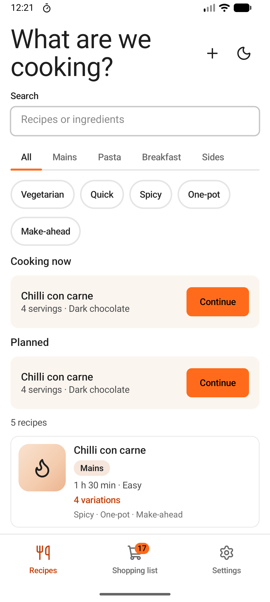

### Recipe detail and editing

Set servings and pick swaps and add-ins. Amounts and steps follow your choices. Edit any recipe, or restore the original.

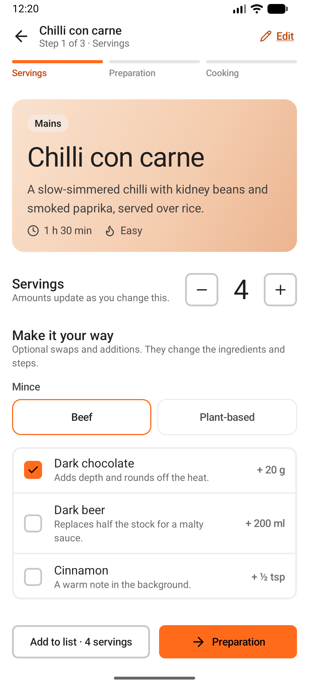
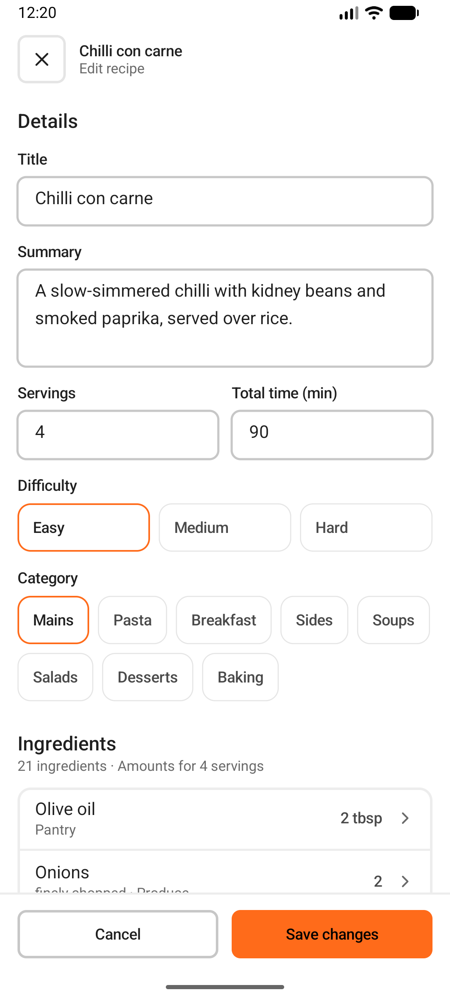

### Cooking and timers

Work through the steps and start a timer on any step that needs one. The timer keeps running in a notification.

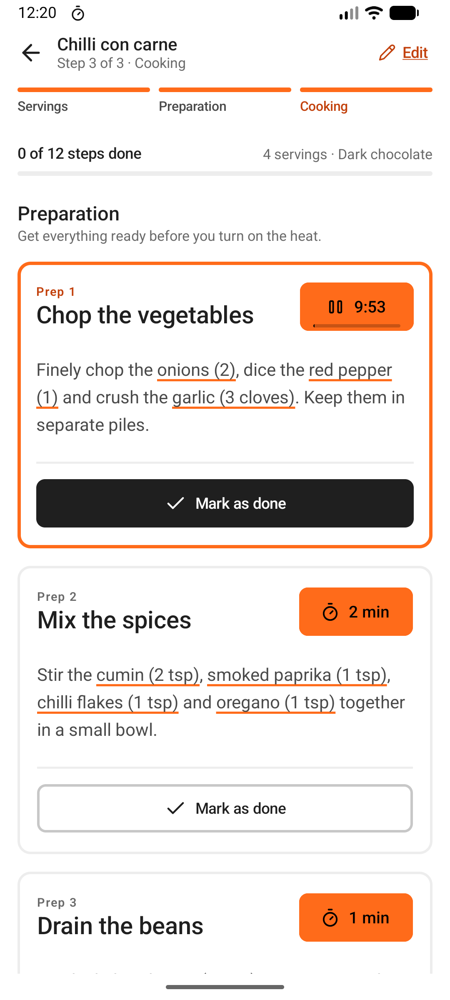
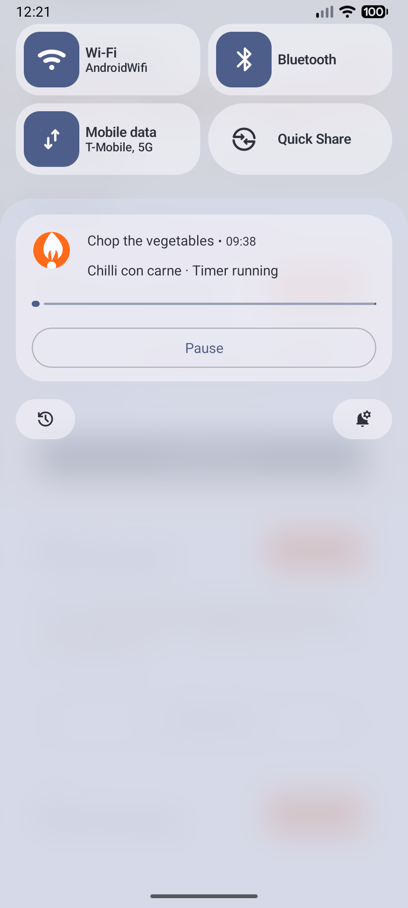

### Shopping list

Planned recipes add their ingredients, grouped by aisle.

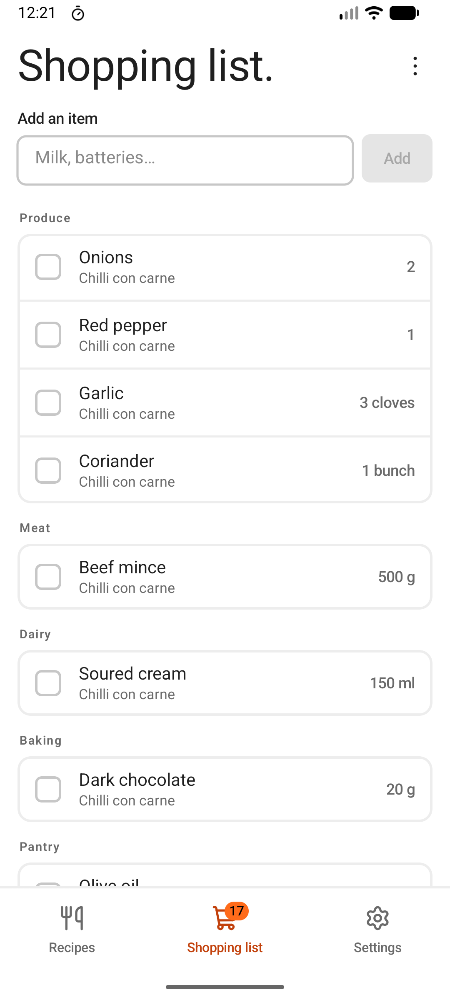

### Add a recipe

Paste a recipe into a chatbot, paste its reply back, and review the result before saving. If a reply does not parse, copy the Fix prompt.

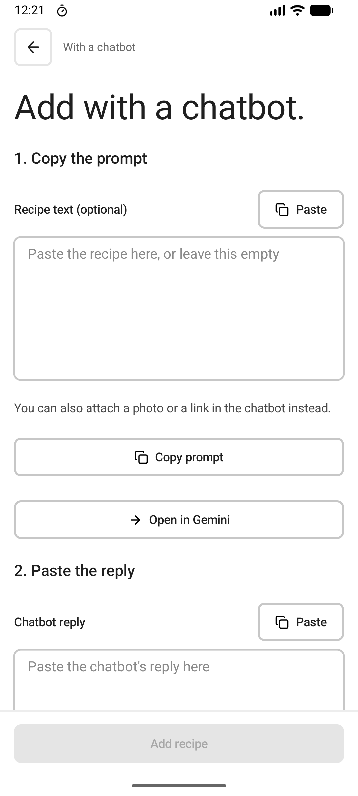
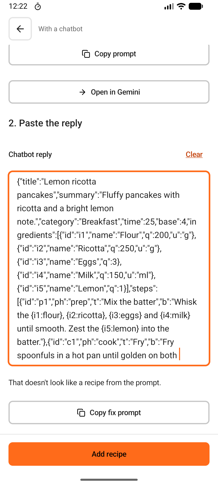
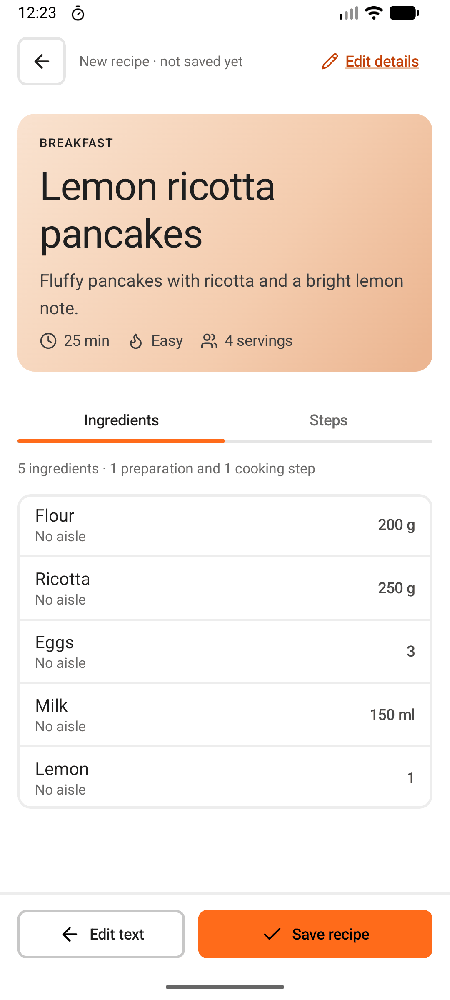

### Add from an Instagram Reel

Share a Reel to Simmer. Its caption lands in the recipe text, and **Listen to the Reel** turns the sound into text on your phone.

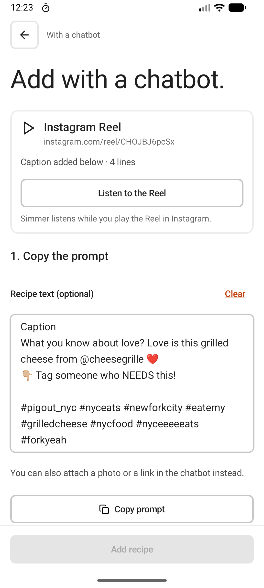

### Your kitchen

Tick the appliances you own, so new recipes only use those.

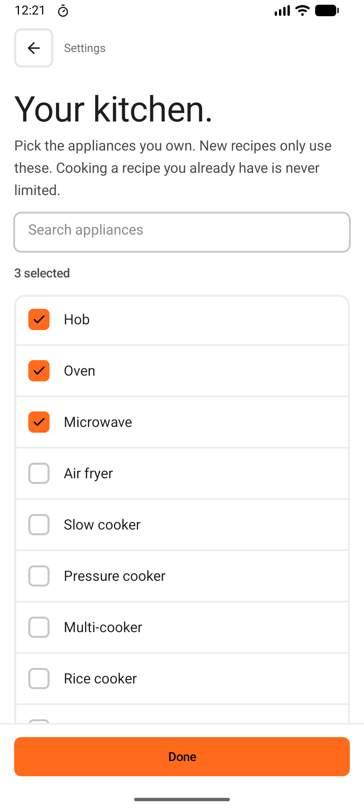

## Install

Simmer is installed by sideloading the APK.

1. Download `simmer-vX.Y.Z.apk` from the [releases page](https://github.com/stefan-meindl/Simmer/releases).
2. Allow "install unknown apps" for the browser or file manager you used, then open the APK.

Requires Android 8.0 or newer (minSdk 26).

If the installer refuses a final release over a release candidate, uninstall the candidate first. See [docs/releasing.md](docs/releasing.md).

## Development

- [Manual testing](docs/manual-testing.md)
- [Releasing](docs/releasing.md)
- [Coding standards](CODING_STANDARDS.md)
- [Glossary](GLOSSARY.md)

## License

[MIT](LICENSE)
